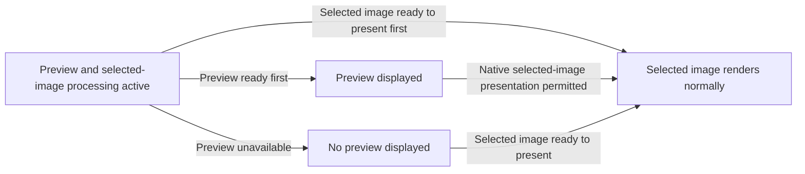

# Image Preview for HTML Images

## Status of this Document

- **Status:** Active draft
- **Draft focus:** Image Preview inputs, lifecycle, responsive images, and art direction, with exploratory companion designs for styling and reveal control.
- **Proposed incubation venue:** [WICG](https://wicg.io/)
- **Expected standards venue:** [WHATWG HTML](https://html.spec.whatwg.org/)
- **Last updated:** 2026-10-30

## Authors

- [Olga Gerchikov](mailto:gerchiko@microsoft.com)
- [Alex Russell](mailto:alexrussell@microsoft.com)

## Participate

- **Issue tracker:** [Image Preview issues](https://github.com/MicrosoftEdge/MSEdgeExplainers/labels/Image%20Preview)
- **File a new issue:** [Image Preview issue template](https://github.com/MicrosoftEdge/MSEdgeExplainers/issues/new?template=image-preview.md)

## Table of Contents

- [Status of this Document](#status-of-this-document)
- [Authors](#authors)
- [Participate](#participate)
- [Introduction](#introduction)
- [User-Facing Problem](#user-facing-problem)
  - [How authors provide previews today](#how-authors-provide-previews-today)
  - [Goals](#goals)
  - [Non-goals](#non-goals)
- [Developer needs and proposal response](#developer-needs-and-proposal-response)
- [Core Proposal](#core-proposal)
  - [Preview values and reflection](#preview-values-and-reflection)
  - [Scope and responsive images](#scope-and-responsive-images)
    - [Art direction and preview ownership](#art-direction-and-preview-ownership)
    - [Responsive preview candidates](#responsive-preview-candidates)
  - [A low-resolution image preview](#a-low-resolution-image-preview)
  - [Fetching, scheduling, and HTML integration](#fetching-scheduling-and-html-integration)
  - [Preview lifecycle](#preview-lifecycle)
  - [Lifecycle decisions](#lifecycle-decisions)
  - [Source updates and image generations](#source-updates-and-image-generations)
  - [Image element state and rendering](#image-element-state-and-rendering)
  - [Compatibility and fallback](#compatibility-and-fallback)
- [Optional Capabilities](#optional-capabilities)
  - [Compact encoded preview formats](#compact-encoded-preview-formats)
  - [Script observability](#script-observability)
- [Open Questions](#open-questions)
  - [Independent preview loading](#independent-preview-loading)
  - [Presentation during source replacement](#presentation-during-source-replacement)
  - [Conditional preview use](#conditional-preview-use)
- [Alternatives considered](#alternatives-considered)
  - [Earlier proposal versions](#earlier-proposal-versions)
    - [URL-only `previewsrc` and `previewSrc`](#url-only-previewsrc-and-previewsrc)
    - [One nonresponsive preview on ``](#one-nonresponsive-preview-on-img)
    - [Mandatory complete-frame handoff](#mandatory-complete-frame-handoff)
    - [Browser-managed View Transitions](#browser-managed-view-transitions)
  - [Alternatives to the core proposal](#alternatives-to-the-core-proposal)
    - [Historical `lowsrc` attribute](#historical-lowsrc-attribute)
  - [Alternatives to the combined solution](#alternatives-to-the-combined-solution)
- [Accessibility, Internationalization, Privacy, and Security Considerations](#accessibility-internationalization-privacy-and-security-considerations)
  - [Accessibility](#accessibility)
  - [Internationalization](#internationalization)
  - [Privacy](#privacy)
  - [Security](#security)
- [Stakeholder Feedback / Opposition](#stakeholder-feedback--opposition)
- [References & acknowledgements](#references--acknowledgements)
  - [Specifications and guidance](#specifications-and-guidance)
  - [Historical `lowsrc` sources](#historical-lowsrc-sources)
  - [Compact preview formats](#compact-preview-formats)
  - [Implementation evidence](#implementation-evidence)
  - [Acknowledgements](#acknowledgements)
- [Appendix](#appendix)
  - [Core API definition](#core-api-definition)
    - [WebIDL](#webidl)
  - [Exploratory CSS styling](#exploratory-css-styling)
    - [Parts and presentation phases](#parts-and-presentation-phases)
    - [Illustrative UA defaults](#illustrative-ua-defaults)
    - [Author styling and transitions](#author-styling-and-transitions)
    - [Outgoing content and remaining design work](#outgoing-content-and-remaining-design-work)
  - [Exploratory image reveal](#exploratory-image-reveal)
  - [Historical `lowsrc` research](#historical-lowsrc-research)
  - [Preview examples](#preview-examples)

## Introduction

**Image Preview lets a page provide a lightweight preview while its main image loads.** The browser replaces the preview when the main image would normally be displayed, including progressive content. If the main image is ready first, it skips the preview. The browser manages this lifecycle instead of requiring site-specific code.

The `preview` attribute accepts an image URL, compact representation, or color. Its reflected property also works on images created with `new Image()`. `previewset` supplies optional density-based candidates. Both attributes apply to `` and `<source>` in `<picture>`, while existing source-selection rules continue to choose the main image.

```html

```

Image Preview does not define compact formats or their encoding and decoding algorithms. Examples such as `blurhash("...")` illustrate integration with separately specified formats.

The [styling](#exploratory-css-styling) and [image-reveal](#exploratory-image-reveal) appendices sketch independent proposals, not dependencies of Image Preview. [Earlier proposal versions](#earlier-proposal-versions) explain the design's evolution.

## User-Facing Problem

Slow-loading images can leave empty regions on a page. A lightweight preview can help users recognize the content before the main image arrives, especially in galleries and feeds.

Sites implement previews with CSS backgrounds, source replacement, or stacked image and canvas elements. They must coordinate decoding, replacement, source changes, and transitions themselves.

### How authors provide previews today

The table below describes the major patterns used by current implementations. Representative examples are provided in the [appendix](#preview-examples).

| Pattern | Format | How it works | Examples and evidence |
| --- | --- | --- | --- |
| 1. CSS background preview with main image overlay | Base64 8×8 BMP; tiny JPEG embedded in SVG; BlurHash-derived WebP; ThumbHash-derived PNG | Set the preview as the CSS background of the target `` or its wrapper. The main image paints over it or becomes opaque after loading. | [Unsplash](https://unsplash.com/); [Next.js `<Image>`](https://image-component.nextjs.gallery/placeholder); [Jesus Film with Next.js](https://github.com/JesusFilm/core/blob/b2825dcb70a75b12a01f536b2f4b9c5637e8c6e8/libs/journeys/ui/src/components/Image/Image.tsx); [Tommy Chow homepage gallery preview](https://tommychow.com/) |
| 2. Decoded compact hash canvas | BlurHash decoded to canvas pixels | Decode the hash in script and paint it into a canvas occupying the image's display area. Load the target `` independently; after it loads or decodes, reveal it and hide or remove the canvas. | [Minds](https://www.minds.com/newsfeed/1565424642032668690); [Mastodon](https://github.com/mastodon/mastodon/blob/main/app/javascript/mastodon/components/blurhash.tsx); [Misskey](https://github.com/misskey-dev/misskey/blob/b3ce198f4c55ace4daeba4cb1858b3a85bc9529b/packages/frontend/src/components/MkImgWithBlurhash.vue); [Nextcloud Talk](https://github.com/nextcloud/spreed/blob/030f4ae2bd69e30077ad7dbac428ace1e9a325d2/src/components/MessagesList/MessagesGroup/Message/MessagePart/FilePreview.vue); [Jellyfin Vue](https://github.com/jellyfin/jellyfin-vue/blob/63edc21f2787706d094a190c93bdc97edd5c233e/packages/frontend/src/components/Layout/Images/Blurhash/BlurhashImage.vue) |
| 3. Single-image source replacement | Cloudinary-transformed raster image; Cloudinary selects the delivered format automatically | Assign the placeholder URL to one ``, preload the main image resource, and replace the same element's `src`. | [Cloudinary training tool](https://cloudinary-training.github.io/cld-intro-react-sdk-training-tool/#/placeholder); [Cico Jazz hero](https://cicojazz.de/#hero); [Cloudinary plugin source](https://github.com/cloudinary/frontend-frameworks/blob/9a05f3571fec1a3d0ecc66a899db1833d326c094/packages/html/src/plugins/placeholder.ts#L10-L108) |
| 4. Progressive stacked preview layers | BlurHash, small thumbnail, and larger preview | Stack progressively better representations and fade in each layer after it loads. | [Nextcloud Photos](https://github.com/nextcloud/photos/blob/d12a25def30bf568d5e36339bea645203f7dba62/src/components/FileComponent.vue) |

### Goals

- Display a temporary preview in the same `` until the main image can be shown.
- Support image URLs, compact representations, and colors as preview inputs.
- Associate previews with the selected `<picture>` branch and support density-based candidates without changing main-image selection.
- Let the browser manage the preview lifecycle, reducing the need for custom markup and script.
- Never delay main-image discovery or request creation, and minimize network contention with the main image.
- Keep the main image and page usable when a preview format is unsupported.
- Preserve native main-image presentation timing, including progressive rendering.

### Non-goals

- Generate a preview from the main image.
- Replace responsive image selection.
- Replace `loading`, `decoding`, or `fetchpriority`.
- Define compact image formats or their encoding and decoding algorithms.
- Accept the full CSS `<image>` grammar, such as gradients, `cross-fade()`, or Paint Worklets, as preview values.
- Define CSS loading decorations or animated handoffs as part of the core API; these belong to the independent styling design.
- Give the preview separate alternative text or separate semantics.
- Expose preview pixels through canvas, WebGL, WebCodecs, or other APIs that consume or extract decoded image data.
- Guarantee that a preview is displayed when the main image has content available for rendering first.

## Developer needs and proposal response

The [developer-needs document](developer-needs.md) records the evidence for these needs and their relationship to the proposal:

| Developer need | Response |
| --- | --- |
| Reduce custom lifecycle code and reuse lightweight preview data (DN-01 through DN-03) | Browser-managed `preview` processing with URL, compact, and color inputs |
| Match responsive images, crops, and color schemes (DN-04) | Branch-specific `preview` and density-based `previewset` on `` and `<source>` |
| Avoid delaying the main image and choose when to use previews (DN-05, DN-06) | Non-blocking, best-effort preview work and author-controlled inputs; independent loading and browser-managed conditional rules remain open |
| Show waiting content, style image pixels, and customize transitions (DN-07 through DN-09) | The independent [CSS styling sketch](#exploratory-css-styling) |
| Choose progressive or complete-first-frame presentation (DN-10) | Native timing in the core proposal; opt-in control in the independent [image-reveal sketch](#exploratory-image-reveal) |
| Handle repeated replacements (DN-11) | Source-generation cancellation in the core; same-role transitions need further styling work |
| Preserve semantics, layout, accessibility, and fallback (DN-12, DN-14) | One semantic image, unchanged selected-image APIs, and normal fallback when loading fails |
| Observe preview success and measure presentation (DN-13) | Preview-specific observability and metric integration remain open |

## Core Proposal

Add `preview` and `previewset` attributes to `` and to `<source>` elements used by `<picture>`.

The preview is temporary visual content painted inside the image element. The **selected image** is the main resource chosen by normal `src`, `srcset`, `sizes`, and `<picture>` processing for the current [image generation](#source-updates-and-image-generations).

Authors should choose a preview that represents the selected image. The browser cannot verify this relationship; unrelated preview content can mislead users.

The proposal is divided along specification and implementation boundaries:

| Capability | Scope | Intended venue |
| --- | --- | --- |
| `preview` and its reflected property; typed URL, compact, and color inputs | Core | WHATWG HTML, coordinating value syntax with CSS |
| `previewset` and branch-specific preview selection in `<picture>` | Core | WHATWG HTML |
| Preview fetching, decoding, display, replacement, and cancellation | Core | WHATWG HTML |
| Compact encodings such as BlurHash or ThumbHash | Independently specified formats and input bindings | Their respective specifications |
| Image-part styling and transitions | Independent exploratory proposal | CSS, coordinated with HTML |
| `image-reveal` | Independent exploratory proposal | CSS, coordinated with HTML |
| Dedicated preview events and metric integration | Open | To be determined |

### Preview values and reflection

The proposed value model distinguishes representations explicitly:

| Kind | Illustrative value | Processing |
| --- | --- | --- |
| Image URL | `url("thumb.avif")` or `url("data:image/avif;base64,...")` | Resolve the URL against the document base URL and use normal image fetching and decoding |
| Compact representation | `blurhash("LEHV6nWB2yk8pyo0adR*.7kCMdnj")` | Use a separately specified format and its preview-value binding; no implied network request |
| Color | `#ccd8e0` | Paint a temporary solid-color representation; no fetch or image decoder |

URLs require `url(...)`. Missing, empty, invalid, or unsupported values provide no preview; they are never reinterpreted as URLs.

The initial color model accepts self-contained CSS colors, such as hex colors, named colors, and `rgb(...)`. It excludes `currentColor`, system colors, `light-dark()`, and `var()`, which would require style-resolution and invalidation rules.

`preview` and `previewset` are string-reflecting `DOMString` properties. Their getters return the authored attribute value, or an empty string when absent. Setters preserve invalid values; parsing determines whether they can supply a preview. Unlike `src`, these getters do not resolve URLs.

```js
const image = new Image();
image.preview = 'url("thumb.avif")';
image.previewset = 'url("thumb.avif") 1x, url("thumb-2x.avif") 2x';
image.src = "photo.avif";
```

An `` property reflects its own attribute, not a selected `<source>` declaration. There is no `currentPreview` property. See the [IDL](#core-api-definition).

### Scope and responsive images

Preview rendering applies only to HTML ``. `<source>` supplies declarations when used in `<picture>`, not in audio or video. The proposal does not extend `<input type="image">`, SVG `<image>`, `<object>`, or `<embed>`.

#### Art direction and preview ownership

First select the main image using the existing `<picture>`, `srcset`, and `sizes` algorithms. The element supplying that image's source set owns its preview declarations:

- If a `<source>` is selected, use only that source's `preview` and `previewset`.
- Otherwise, use the `` element's declarations.
- A selected `<source>` with no usable preview does **not** inherit the `` preview. It might represent a different crop, subject, locale, or color scheme.
- Preview availability never changes main-image source selection. A preview failure does not select a different `<source>`.

For example, the dark-mode branch supplies its own preview:

```html
<picture>
  <source
    media="(prefers-color-scheme: dark)"
    srcset="chart-dark-800.avif 800w, chart-dark-1600.avif 1600w"
    sizes="(max-width: 800px) 100vw, 800px"
    preview='url("chart-dark-preview.avif")'>
  
</picture>
```

The dark branch uses its own preview, avoiding a light-preview flash. The same rule handles different crops and other art direction; the browser does not recolor or recrop previews. Authors can repeat a shared preview on branches where it is appropriate.

#### Responsive preview candidates

The same preview can represent every resolution in an `` or `<source>` source set. Authors do not need a separate preview for each main-image URL.

For different preview sampling densities, `previewset` provides a list of typed preview values with positive `x` density descriptors:

```html

```

`1x` identifies the author's baseline preview quality; `2x` provides higher sampling density. Neither promises a sharp image at the element's display size or changes its intrinsic dimensions.

The proposed selection rules are:

1. Parse the owning branch's list. A missing descriptor means `1x`; densities must be positive, finite, and unique. Width descriptors and a separate `previewsizes` attribute are not included.
2. Exclude unsupported representation kinds, then select at most one candidate using the policy for `srcset` with `x` descriptors, including device density and browser resource policy. Do not fetch every candidate or cycle through them as quality steps.
3. If the list is absent, empty, malformed, or has no supported candidate, use that branch's `preview`. A usable list takes precedence; `preview` is not an implicit additional `1x` candidate.
4. Once a candidate is selected, a fetch or decode failure follows the normal preview-unavailable lifecycle. It does not trigger a retry chain through the other candidates or `preview`.

The list accepts the same value kinds as `preview`. Commas inside functions or strings are not candidate separators. The main image's `sizes` does not apply to preview-resource widths, and the browser does not prefetch URLs to check format support.

Changes in branch or preview selection participate in the [source-update lifecycle](#source-updates-and-image-generations), even when the main-image URL stays the same.

### A low-resolution image preview

An author can use a small, low-resolution JPEG, WebP, or AVIF image as the preview:

```html

```

An inline value such as `preview='url("data:image/avif;base64,...")'` avoids a separate request but increases document size.

### Fetching, scheduling, and HTML integration

Preview processing integrates with HTML's [update the image data](https://html.spec.whatwg.org/multipage/images.html#update-the-image-data) algorithm:

1. Select the main image and create or update its request.
2. Choose a preview using the [ownership](#art-direction-and-preview-ownership) and [candidate-selection](#responsive-preview-candidates) rules. Unselected branches and candidates do not initiate preview work.
3. When selected-image loading is eligible, the browser may fetch and decode the URL preview, decode a compact value, or prepare a color.

Without a valid main-image candidate, pending preview work becomes obsolete and any displayed preview is removed. Normal no-source or broken-image rendering applies; a preview is not a standalone image or fallback source.

When a URL preview resolves to the selected-image URL, the browser may reuse the same fetch and decode rather than perform duplicate work. The resource is treated as the selected image and does not participate in the preview lifecycle.

Selected-image discovery, selection, and request creation must not wait for preview work. Preview processing is best-effort and decoding is asynchronous, although an additional request can still compete for bandwidth.

`fetchpriority` and `decoding` continue to describe the selected image. There is no preview-specific priority control. The browser may skip a preview that is unlikely to be useful before the selected image appears.

The browser fetches a URL preview as an image resource, following the same fetching and security rules as other `` requests. These include URL parsing, CORS, credentials, referrer policy, Content Security Policy `img-src`, mixed content, cookies, HTTP caching, network partitioning, and service-worker handling. Request policies come from the host ``, even for declarations on `<source>`. A separately fetched preview produces a Resource Timing entry under the usual image-request rules, with `initiatorType` equal to `"img"`.

Literal colors and compact payloads do not initiate requests or produce Resource Timing entries. Their processing rules are covered under [Security](#security) and [compact formats](#compact-encoded-preview-formats).

### Preview lifecycle

*Ready to present* means that content is available and the applicable rendering policy permits displaying it. This is determined before painting. The core uses native main-image timing, including progressive rendering.

The proposed flow for an initial presentation is:



The numbered steps below are the text alternative for the diagram:

1. Preview processing and selected-image loading proceed independently under the [fetching and scheduling rules](#fetching-scheduling-and-html-integration).
2. If the selected image is ready to present first, skip the preview for that generation. If both are ready at the same presentation decision, prefer the selected image.
3. If the preview is ready first, display it in the ``.
4. When native rendering policy permits presenting the selected image, replace the preview directly, including with a progressive representation. Do not wait for a complete first frame merely because a preview was displayed.
5. Once the selected image is presented, later refinements update it normally and the preview cannot return for that generation.
6. A skipped, blocked, unsupported, malformed, or failed preview leaves no preview displayed and does not alter loading or rendering of the selected image.

The core handoff does not animate.

### Lifecycle decisions

- **Lazy loading:** Deferring the selected image with `loading="lazy"` also defers preview processing. Independent preview loading remains an [open question](#independent-preview-loading).
- **Selected-image failure:** If the selected image fails, the browser stops displaying the preview and uses the element's normal broken-image and alternative-text rendering. A preview is temporary and cannot become successful fallback content.
- **Animated previews:** The host's computed [`image-animation`](https://drafts.csswg.org/css-image-animation-1/#image-animation) value applies to both preview and selected-image animations. Replacing the preview ends its playback. There are no preview-specific animation controls.
- **Animated selected images:** Native image presentation and animation timing apply. The core does not wait for the full animation or introduce a new first-frame threshold.
- **Data-saving and resource pressure:** The browser may omit or abandon a preview in response to reduced-data preferences, memory pressure, battery constraints, or similar policy.
- **Disconnection:** Disconnecting an element makes preview work obsolete when the corresponding selected-image request is no longer relevant under the existing image-loading model. Reconnection runs the normal image-data update process.
- **Document lifecycle:** Already-painted and decoded state may be preserved for BFCache to the same extent as ordinary `` state. Discarding the document makes preview work obsolete. Any companion styling proposal must separately define its transition lifecycle.

### Source updates and image generations

Script can update the reflected preview property and the image source, as in a dynamic image gallery:

```js
const image = document.querySelector("#gallery-image");

image.preview = photo.previewValue;
image.src = photo.url;
```

`photo.previewValue` contains a value such as `url("thumb.avif")`, not a bare URL. If a `<source>` supplies the selected image, update that source's preview declarations instead.

Changes to `preview`, `previewset`, `src`, `srcset`, `sizes`, and relevant `<source>` elements or selection conditions participate in HTML's existing image-data update processing. An *image generation* identifies the selected branch, main-image request, and chosen preview value; it is not a script-visible object.

Results from superseded work cannot newly replace current content. The browser cancels obsolete fetching and decoding when possible. In particular:

- A branch change invalidates and removes its preview, even if both branches use the same main-image URL.
- A resolution-only change within one branch can reuse an unchanged preview while the newly selected image loads.
- A preview-candidate change while the preview is eligible invalidates the old candidate's work. Changing preview declarations after the same selected image has been presented does not hide that image or reopen its preview phase.
- Previously presented main-image content can remain under ordinary HTML replacement rules. Whether a new preview should replace such retained content is an explicit [open question](#presentation-during-source-replacement).

### Image element state and rendering

The browser temporarily displays the preview inside the image element, but the selected image remains the element's current image resource. Standard `HTMLImageElement` state and events, including `currentSrc`, `complete`, `naturalWidth`, `naturalHeight`, `decode()`, `load`, and `error`, continue to describe the selected image.

The preview does not determine the `` element's intrinsic dimensions or layout size. Normal CSS, `width`, `height`, `aspect-ratio`, and selected-image sizing rules apply, including existing `<source>` dimension handling.

A decoded image preview is fitted to the content box using `object-fit` and `object-position`. Compact formats define their decoded dimensions and aspect ratio. A color has no intrinsic dimensions and fills the box. Normal image-content clipping applies.

A preview may be fetched and decoded before a nonzero content box exists, but cannot be painted until one exists and the preview remains eligible. Authors should reserve space with `width` and `height`, `aspect-ratio`, or CSS sizing. The selected image's intrinsic dimensions can still affect layout under normal rules.

The preview is not exposed through `drawImage()`, `createImageBitmap()`, or other image-extraction APIs. These APIs follow their existing selected-image algorithms independently of what is presented; they never substitute preview pixels.

On replacement, the preview is removed rather than left behind transparent parts of the selected image. This distinguishes a color preview from a persistent background. The independent styling design explores keeping outgoing content available during transitions.

Context menus, drag operations, saving, accessibility, and other semantics continue to identify the selected image and its `src`/`currentSrc`, not the preview.

### Compatibility and fallback

In a browser that does not implement Image Preview, the unrecognized `preview` and `previewset` attributes have no effect and the existing image source attributes continue to work.

Script can detect support for the reflected property:

```js
const supportsImagePreview =
  "preview" in HTMLImageElement.prototype;
```

This detects the property, not support for a particular compact format. `previewset` and the `<source>` properties can likewise be checked on their corresponding prototypes. Unsupported representations follow the candidate-selection and [preview-unavailable lifecycle](#preview-lifecycle) rules.

Developer tools may report that a preview was skipped, blocked, unsupported, or failed, but such diagnostics are not a web-observable API and are outside the HTML feature definition.

## Optional Capabilities

### Compact encoded preview formats

Each compact format needs a separate specification and a preview-value binding that defines its function name, payload syntax, and decoding behavior.

BlurHash and ThumbHash are examples of representations that could be integrated. The function below is illustrative, pending that work:

```html

```

A format binding must define encoded-size, output-dimension, memory, and processing limits; color and alpha behavior; malformed-input handling; and a prohibition on nested network requests. It must not depend on author-provided decoder script.

### Script observability

The core provides no preview lifecycle hook. Resource Timing describes separately fetched previews but does not report whether they decoded or were displayed.

## Open Questions

### Independent preview loading

Should authors be able to load and display a preview before a lazy-loaded selected image?

Loading the preview eagerly could reduce visible pop-in when an image approaches the viewport. For an inline preview, the bytes are already part of the document, although decoding and retaining the preview still have CPU and memory costs. For an external preview, eager loading could fetch resources for images the user never sees and compete with more important requests.

It remains open whether inline and external previews should follow the same loading policy and how authors could control them independently.

### Presentation during source replacement

If image A is already presented while image B loads, should a newly ready preview B replace A, or should A remain until B can be presented? The former gives early context for the new resource; the latter avoids replacing an existing image with lower-detail content.

The lifecycle must define this choice. The rules against displaying stale results or old-branch previews apply either way.

### Conditional preview use

Authors can decide whether to provide a preview, including from script. Whether browsers should offer a rule such as "use previews only on slow connections" remains open.

## Alternatives considered

### Earlier proposal versions

These earlier designs explain the proposal's evolution. Some remain useful alternatives for specific use cases.

#### URL-only `previewsrc` and `previewSrc`

The earlier API accepted one image URL and used URL reflection, like `src`:

```html

```

Compact representations would require a separately specified image format. A hypothetical data URL could look like this:

```html

```

The URL-only design reused ordinary image fetching and decoding, but required every preview to be represented as an image resource, whether referenced by an external URL or embedded in a data URL. Even a solid-color preview needed an image resource rather than a color value.

General image-format support would also need to address compact encodings in ``, CSS [`background-image`](https://drafts.csswg.org/css-images-3/#url-notation), and other platform primitives that load image resources. Low-detail previews may not suit all these contexts. Keeping decoding preview-only would require special rules.

`preview` instead accepts preview-specific compact-format bindings and colors without requiring support in other image consumers. It retains `url(...)` for ordinary image resources and reflects all values as authored strings.

#### One nonresponsive preview on ``

The earlier draft used one `previewsrc` on `` for all main-image candidates, reducing scope but risking mismatched crops or color schemes. The revised design supports source-specific previews and density-based `previewset`, with no fallback from a selected `<source>` to the `` preview.

#### Mandatory complete-frame handoff

The earlier design retained a displayed preview until the main image's first frame was complete and decoded, matching scripted `decode()` handoffs but hiding progressive content. The core now preserves native timing regardless of whether a preview appears. The independent `image-reveal: complete-frame` sketch makes waiting an explicit author choice.

#### Browser-managed View Transitions

The earlier sketch proposed automatic [Element Scoped View Transitions](https://developer.mozilla.org/en-US/docs/Web/API/View_Transition_API/Using_element-scoped) to animate from a preview snapshot to the main image's complete decoded first frame:

```css
img:active-image-preview-transition::view-transition-old(root) {
  animation: 200ms ease-out both image-preview-fade-out;
}

img:active-image-preview-transition::view-transition-new(root) {
  animation: 200ms ease-in both image-preview-fade-in;
}

@keyframes image-preview-fade-out {
  to { opacity: 0; }
}

@keyframes image-preview-fade-in {
  from { opacity: 0; }
}
```

The independent [CSS styling sketch](#exploratory-css-styling) is preferred because it can style waiting content, previews, and the main image throughout loading, not just during a handoff. Waiting and main-image styling also work without Image Preview.

Scoped View Transitions could still complement these parts for image-to-image replacements without a phase change, but would require additional resource-triggered integration.

### Alternatives to the core proposal

#### Historical `lowsrc` attribute

The historical `lowsrc` attribute associated a temporary low-resolution image with the main image. Image Preview adapts that idea to modern HTML while retaining the costs of a separate resource.

See [Historical `lowsrc` research](#historical-lowsrc-research) for its standards history, Gecko removal, and available usage evidence.

#### CSS property for the preview source

A CSS property could provide the preview instead of, or alongside, the HTML attribute:

```css
.gallery-image {
  image-preview-source:
    linear-gradient(135deg, #68788c, #bcc4cc);
}
```

Compared with the HTML `preview` input, this has several advantages:

- It can accept the full CSS `<image>` syntax.
- CSS rules and queries can select and reuse previews.
- Abstract placeholders remain in the presentation layer.

It also has disadvantages:

- Preview URLs may be discovered only after stylesheets are fetched and parsed, leaving less time for the preview to appear before the selected image.
- Keeping the preview separate from the image's source attributes makes it easier for the preview and selected image to become mismatched.
- Cascade or query changes may replace a preview while loading, causing requests or decoding work to be restarted or discarded.
- Without a reflected `HTMLImageElement` property, scripts must read and update the preview through styles instead of the image API.

CSS would still need display and replacement rules. The proposed division keeps preview content in HTML for early discovery and uses CSS for appearance and waiting decoration.

#### Imperative-only image API

The browser-managed preview lifecycle could be exposed only through JavaScript:

```html

```

```js
const image = document.querySelector("#gallery-image");

image.setPreviewSource("/images/forest-32.avif");
```

This would support imperative options but require script before the browser could discover the preview. The reflected `preview` attribute instead supports both server-rendered markup and script updates.

#### Preview source in `<picture>`

A special `media="poster"` value on a `<source>` element could identify that source as the preview rather than as a selected-image candidate:

```html
<picture>
  <source media="poster" srcset="/images/forest-preview.avif">
  <source
    media="(min-width: 800px)"
    srcset="/images/forest-1600.avif">
  
</picture>
```

This keeps preview and main-image sources together, but requires `<picture>` for every preview. It also repurposes `media` to identify a source's role rather than evaluate a media query.

The proposed `preview` and `previewset` attributes instead annotate the existing `` or selected `<source>`, without giving `media` a special role or requiring `<picture>` when no art direction is needed.

#### Reuse the `poster` attribute

The `<video>` element uses `poster` to identify an image shown before video data is available. The same attribute could be added to ``:

```html

```

This would reuse a familiar name for temporary content, while still requiring image-preview lifecycle rules and a reflected property. Related work in [whatwg/html#12585](https://github.com/whatwg/html/pull/12585) proposes responsive video posters through a child ``, not a `poster` attribute on ``.

This draft uses `preview` because the value can be a compact payload or color, unlike the existing URL-valued `poster`.

#### Progressive and incrementally decoded images

Progressive JPEG, interlaced formats, and incremental decoding can reveal an image as its bytes arrive. They avoid a separate request and can be preferable when the format, delivery path, and browser produce useful intermediate content.

They do not replace every preview use case:

- Intermediate quality and paint timing depend on the format, encoding parameters, decoder, and browser.
- A site cannot provide a separately generated semantic preview, compact hash, or differently processed placeholder independently of the selected resource.
- A site's selected-image format or image CDN might not support predictable progressive rendering.
- Changing the selected source because of responsive selection, art direction, or application state also changes the progressive stream.

An independent preview can reuse a small image, travel inline, or be cached separately. It adds transfer or processing costs and may compete for bandwidth. Image Preview complements progressive delivery rather than replacing it; authors should omit previews when progressive rendering already provides an adequate experience.

### Alternatives to the combined solution

These alternatives combine native decoding, existing transition APIs, and author script differently.

#### Native compact-format decoding with an author-managed lifecycle

The browser could decode compact formats while authors manage replacement through ordinary image or canvas APIs. This example assumes a separately specified format and hypothetical media type:

```html
<div class="image-frame">
  
  
</div>
```

This could remove decoder libraries and reduce script size and decoding cost. Authors would still manage loading, replacement, cancellation, source changes, failures, and accessibility across elements.

#### Author-scripted scoped View Transition

The platform could provide native compact decoding and scoped View Transitions but leave the handoff to author script:

```html

```

```js
const photo = document.querySelector("#photo");
const finalImage = new Image();
finalImage.src = "/images/portrait.jpg";
await finalImage.decode();

const transition = photo.startViewTransition(async () => {
  photo.src = finalImage.src;
  await photo.decode();
});

await transition.finished;
```

This reuses a general transition API but leaves preloading, stale-update handling, failure, and cancellation to each page. Image Preview instead lets the browser manage loading and replacement.

#### Script-provided fallback decoder

The browser could manage the preview lifecycle but invoke an author-registered decoder when it does not support the preview's media type:

```html

```

```js
navigator.imagePreview.registerDecoder(
  "image/blurhash",
  async (bytes, options) => decodeBlurHash(bytes, options)
);
```

This would allow new formats without native decoders, but make previews depend on script loading and execution. It also requires rules for decoder lifetime, cancellation, security, failures, dimensions, color, and resource limits.

## Accessibility, Internationalization, Privacy, and Security Considerations

### Accessibility

The preview and selected image share one ``, one accessibility node, and one `alt` value. The preview must represent that same content without creating a second announcement.

Showing a preview can replace the visible loading-time alt text that some browsers display. The description remains available to assistive technologies, but sighted users may lose information that a blurred preview cannot convey.

The core handoff does not animate. Independent styling must respect reduced-motion preferences and keep informative loading indicators distinguishable from their backgrounds. Encoded preview animations follow existing image-animation controls. [Branch-specific previews](#art-direction-and-preview-ownership) can avoid a light-preview flash before dark-mode content.

### Internationalization

The proposal adds no user-facing text and no language-sensitive processing.

The guidance for localized or direction-dependent image candidates is covered by [Scope and responsive images](#scope-and-responsive-images).

### Privacy

Fetching an external URL preview discloses an ordinary image request and its metadata to the serving origin. Unselected branches and candidates are not fetched. Literal colors and compact payloads make no requests.

Resource Timing exposes ordinary fetch and cache information under existing [image-request protections](#fetching-scheduling-and-html-integration). The core adds no dedicated signals for preview readiness, dimensions, decoding, display, handoff timing, or the reason a preview was skipped.

Candidate selection can reveal format support indirectly. Rejecting an unsupported compact value may cause a URL fallback request, observable through network information or by the server.

A site can also time decoding or drawing the same resource through another `Image`, `createImageBitmap()`, canvas, or WebGL. Shared caches may affect those timings, but they do not directly measure the internal preview decode or reveal whether it was displayed.

The styling sketch would expose coarse presentation state through selectors and inspectable transitions. Its independent proposal requires privacy analysis of timing and format-support inferences.

### Security

URL previews follow the host image's [fetch protections](#fetching-scheduling-and-html-integration), including CSP `img-src` and mixed-content rules. Unsupported or malformed values are never reinterpreted as URLs.

Literal colors and compact payloads are inline author data. They do not trigger `img-src` request checks, execute script, resolve style variables, or fetch nested resources. Parsing and processing must be bounded.

Decoding must enforce the [format-specific limits](#compact-encoded-preview-formats). Obsolete work must be abortable, and repeated source changes must not create unbounded concurrent decoding. Malformed or adversarial input follows the [preview-unavailable lifecycle](#preview-lifecycle). Each compact-format binding requires its own security review.

Preview pixels are unavailable to image-extraction APIs, so their origin does not independently affect canvas origin cleanliness. Canvas access follows the selected image's origin-clean rules.

## Stakeholder Feedback / Opposition

| Stakeholder | Signal | Source |
| --- | --- | --- |
| Chromium | No position requested | — |
| Gecko | No position requested | — |
| WebKit | No position requested | — |
| WHATWG | No review requested | — |
| Web developers | Requests and concerns about art direction, lazy previews, styling, progressive rendering, formats, and visible alt text; not consensus on this API | [Developer needs and evidence](developer-needs.md) |

## References & acknowledgements

### Specifications and guidance

- [Content Security Policy Level 3](https://www.w3.org/TR/CSP3/)
- [CSS Image Animation Module Level 1](https://drafts.csswg.org/css-image-animation-1/)
- [CSS Transitions Level 2](https://drafts.csswg.org/css-transitions-2/)
- [CSS View Transitions Module Level 2](https://www.w3.org/TR/css-view-transitions-2/)
- [HTML: Images](https://html.spec.whatwg.org/multipage/images.html)
- [Image Preview developer needs and evidence](developer-needs.md)
- [Mixed Content](https://www.w3.org/TR/mixed-content/)
- [Referrer Policy](https://www.w3.org/TR/referrer-policy/)
- [Resource Timing Level 2](https://www.w3.org/TR/resource-timing/)

### Historical `lowsrc` sources

- [Netscape Client-Side JavaScript Reference: `Image`](https://docs.oracle.com/cd/E19957-01/816-6408-10/image.htm)
- [Microsoft `IHTMLImgElement::lowsrc`](https://learn.microsoft.com/en-us/previous-versions/windows/internet-explorer/ie-developer/platform-apis/aa752253(v=vs.85))
- [DOM Level 1: `HTMLImageElement`](https://www.w3.org/TR/REC-DOM-Level-1/level-one-html.html#ID-17701901)
- [DOM Level 2 HTML changes](https://www.w3.org/TR/DOM-Level-2-HTML/changes.html)
- [HTML: obsolete `lowsrc` attribute](https://html.spec.whatwg.org/multipage/obsolete.html#attr-img-lowsrc)
- [Mozilla bug 92453: remove `lowsrc` support](https://bugzilla.mozilla.org/show_bug.cgi?id=92453)
- [Mozilla bug 94219: reported `lowsrc` compatibility](https://bugzilla.mozilla.org/show_bug.cgi?id=94219)
- [WebKit bug 12305: `lowsrc` property compatibility](https://bugs.webkit.org/show_bug.cgi?id=12305)

### Compact preview formats

- [BlurHash](https://github.com/woltapp/blurhash)
- [ThumbHash](https://github.com/evanw/thumbhash)

### Implementation evidence

- [Cloudinary placeholder plugin](https://github.com/cloudinary/frontend-frameworks/blob/9a05f3571fec1a3d0ecc66a899db1833d326c094/packages/html/src/plugins/placeholder.ts#L10-L108)
- [Mastodon BlurHash component](https://github.com/mastodon/mastodon/blob/main/app/javascript/mastodon/components/blurhash.tsx)
- [Minds BlurHash directive](https://github.com/Minds/front/blob/e51f12214cf9324c5e432362e16cf289054a2ca7/src/app/common/directives/blurhash/blurhash.directive.ts)
- [Nextcloud Photos progressive preview component](https://github.com/nextcloud/photos/blob/d12a25def30bf568d5e36339bea645203f7dba62/src/components/FileComponent.vue)
- [Next.js Image documentation](https://nextjs.org/docs/pages/api-reference/components/image) and [placeholder demo](https://image-component.nextjs.gallery/placeholder)
- [Tommy Chow Photography ThumbHash implementation](https://github.com/tommyxchow/tommychow.com/blob/a2fac8f866e608c37b711b024ab873e326287733/src/app/GalleryPreview.tsx)

### Acknowledgements

The authors acknowledge the BlurHash and ThumbHash projects and the application and framework developers whose implementations informed this proposal. Their inclusion does not imply endorsement.

## Appendix

### Core API definition

#### WebIDL

The properties use the [string-reflection rules](#preview-values-and-reflection) described above:

```webidl
partial interface HTMLImageElement {
  [CEReactions] attribute DOMString preview;
  [CEReactions] attribute DOMString previewset;
};

partial interface HTMLSourceElement {
  [CEReactions] attribute DOMString preview;
  [CEReactions] attribute DOMString previewset;
};
```

### Exploratory CSS styling

This **independent proposal sketch** addresses [DN-07 through DN-09](developer-needs.md#dn-07-show-waiting-content-before-a-preview-is-available) and part of [DN-11](developer-needs.md#dn-11-handle-repeated-image-replacement). Its syntax and lifecycle rules are exploratory, not existing CSS.

Placeholder and image styling can work without Image Preview; `::preview` and the `preview` phase would be extensions. This partially addresses [w3c/csswg-drafts#7467](https://github.com/w3c/csswg-drafts/issues/7467), without replacing general loading/error selectors.

#### Parts and presentation phases

The combined pseudo-tree is:

```text

└── ::image-group
    ├── ::image-placeholder
    ├── ::preview             (preview extension)
    └── ::image
```

| Part | Purpose |
| --- | --- |
| `::image-group` | Content-only geometry, shared clipping, and compositing isolation |
| `::image-placeholder` | CSS waiting decoration, such as a color, gradient, or shimmer |
| `::preview` | The representation supplied by the selected preview declaration |
| `::image` | The ordinary image-rendering path, styled independently of the host border and padding |

These are internal rendering parts, not DOM children. They do not size the host or duplicate image painting. The `` retains its layout, borders, padding, accessibility, and existing APIs. HTML still governs native alt-text and broken-image rendering.

The group occupies the image content box without requiring `position: relative` on the host. It clips filtered content to the intended boundary and isolates blending from the page backdrop. The exact interaction with `object-fit`, `object-position`, rounded corners, and filters needs specification.

The read-only `:image-phase(...)` selector describes the **presentation target**: the content selected for display.

| Phase | Condition |
| --- | --- |
| `none` | No preview or ordinary-image target, and no pending initial presentation; native empty/error fallback applies |
| `waiting` | A selected image is pending, including lazy deferral, with neither preview nor ordinary-image content retained as the target |
| `preview` | A usable preview is the current target; available only with the preview extension |
| `image` | Ordinary image content is the target, possibly progressive or retained from a previous request |

Phases are determined before painting, independently of author opacity or visibility. `image` does not mean that loading, decoding, or a transition has finished. It can remain active while an old image is retained during a new request. Removing `src` does not produce `none` if another source still selects an image.

Without preview use or part styling, ordinary image behavior remains unchanged. Hiding a part must not make decoding depend on the very phase change that decoding would trigger.

#### Illustrative UA defaults

These illustrative defaults require browser support for the parts' geometry, content, and lifetime; they are not a polyfill:

```css
img::image-group {
  overflow: clip;
  isolation: isolate;
  pointer-events: none;
  object-fit: inherit;
  object-position: inherit;
}

img::image-placeholder,
img::preview,
img::image {
  display: block;
  opacity: 1;
  mix-blend-mode: normal;
  transition: none;
  animation: none;
}

img::preview,
img::image {
  object-fit: inherit;
  object-position: inherit;
}

img:where(:not(:image-phase(waiting)))::image-placeholder,
img:where(:not(:image-phase(preview)))::preview {
  display: none !important;
  opacity: 0;
}

@starting-style {
  img::image-placeholder,
  img::preview {
    opacity: 0;
  }
}
```

The important `display: none` rule prevents authors from permanently retaining inactive placeholder/preview parts. A running transition can temporarily override it. Entry starting styles apply only to those additional parts. **The UA never hides `::image` based on a phase**, and no transition runs by default.

#### Author styling and transitions

```html

```

```css
.photo::image-placeholder {
  background: linear-gradient(135deg, #e2e8f0, #cbd5e1);
}

.photo::preview {
  filter: blur(4px);
}

.photo::image-placeholder,
.photo::preview,
.photo::image {
  mix-blend-mode: plus-lighter;
}

.photo::image-placeholder,
.photo::preview {
  transition:
    opacity 180ms,
    display 180ms allow-discrete;
}

.photo::image {
  transition: opacity 180ms;
}

.photo:not(:image-phase(image))::image {
  opacity: 0;
}

@media (prefers-reduced-motion: reduce) {
  .photo::image-placeholder,
  .photo::preview,
  .photo::image {
    transition: none;
    animation: none;
  }
}
```

This stylesheet opts into a gradient placeholder, a blurred preview, and a crossfade to the main image. The browser skips unavailable stages; it must not manufacture a placeholder flash to run an animation. The author, not the UA defaults, chooses to fade in `::image`.

Within the isolated group, `plus-lighter` supports alpha-correct crossfading when outgoing and incoming opacities are complementary. Different timings or interrupted transitions are not automatically normalized. Isolation neither clips content nor makes it opaque.

Authors can pause a placeholder's loading animation when `waiting` ends or let it continue through the outgoing fade.

#### Outgoing content and remaining design work

The key retention mechanism is a discrete `display` transition, not an opacity animation:

1. When a placeholder or preview loses its role, retain its rendering instance through the style change to `display: none`.
2. A `display` transition with `allow-discrete` may keep that outgoing instance rendered while its exit effect runs.
3. Release the outgoing rendering reference when the part is no longer rendered. Opacity, transform animations, animation fill, and infinite shimmers do not independently keep it alive.
4. If the part becomes active again, cancel pending removal and retarget transitions from their current values. A stale completion must not remove a newly active part.

This requires new lifecycle rules, not just CSS declarations. Outgoing animated previews can remain live, but keeping them available must not delay selected-image loading events or `decode()`.

Further rules are needed for excessive or stalled exit transitions, resource pressure, document freezing, and failure. Outgoing decoration must not indefinitely cover native fallback. Releasing a rendering reference does not require immediate eviction from shared caches.

Phases alone cannot trigger image-to-image or preview-to-preview transitions when the phase stays unchanged. Resource-triggered transitions, possibly reusing [scoped View Transitions](#browser-managed-view-transitions), need further design. The [replacement policy](#presentation-during-source-replacement) is a separate lifecycle decision.

The styling proposal must also address [presentation-state exposure](#privacy) and [accessibility](#accessibility).

### Exploratory image reveal

This independent sketch addresses [DN-10](developer-needs.md#dn-10-control-progressive-versus-complete-frame-presentation). It controls **when the main image becomes the presentation target**, not the handoff's appearance or duration.

```css
.photo {
  image-reveal: normal;
}

.photo.quality-first {
  image-reveal: complete-frame;
}
```

| Value | Proposed behavior |
| --- | --- |
| `normal` (initial value) | Preserve native presentation timing, including progressive rendering |
| `complete-frame` | Present a new main-image representation only when native presentation is permitted and the first frame is completely available and decoded |

The policy applies with or without previews or CSS parts, including when replacing retained image content. For animated images, `complete-frame` concerns only the first frame.

With `complete-frame` and a 180 ms crossfade, the browser waits for the complete decoded first frame, selects it for display, then runs the transition.

Source selection, fetching, `load`, `decode()`, and image-extraction APIs remain unchanged. The property does not create or remove `::image`. Changing it must not hide an image already presented for that generation. Switching to `normal` while waiting may reveal available progressive content.

Failure uses normal error/alt rendering, not a permanent preview fallback. The separate proposal must specify dynamic changes, retained-content handling, inheritance, and integration with HTML rendering.

### Historical `lowsrc` research

This section records the evidence used to evaluate `lowsrc` as prior art. It does not establish a single reason why the feature declined across the web.

#### Standards history

`LOWSRC` originated as a [Netscape extension](https://docs.oracle.com/cd/E19957-01/816-6408-10/image.htm) and was later [implemented by Internet Explorer](https://learn.microsoft.com/en-us/previous-versions/windows/internet-explorer/ie-developer/platform-apis/aa752253(v=vs.85)). It allowed an `` to specify a low-resolution resource that was displayed before the main `src` resource.

The attribute was never part of the HTML standard. [DOM Level 1 exposed the `lowSrc` property](https://www.w3.org/TR/REC-DOM-Level-1/level-one-html.html#ID-17701901), but [DOM Level 2 removed it](https://www.w3.org/TR/DOM-Level-2-HTML/changes.html).

[Current HTML](https://html.spec.whatwg.org/multipage/obsolete.html#attr-img-lowsrc):

- makes the `lowsrc` content attribute non-conforming;
- recommends progressive JPEG instead of two separate images; and
- retains `HTMLImageElement.lowsrc` as a URL-reflecting compatibility property.

#### Gecko removal

[Mozilla bug 92453](https://bugzilla.mozilla.org/show_bug.cgi?id=92453) documents Gecko's 2001 decision to remove its `lowsrc` loading behavior. The discussion identifies implementation problems, the feature's non-standard status, and questions about its usefulness.

#### Usage evidence

Historical browser bug reports provide some evidence of `lowsrc` markup or property usage, including [Ameritrade](https://bugzilla.mozilla.org/show_bug.cgi?id=94219#c3), [gimp.org](https://bugzilla.mozilla.org/show_bug.cgi?id=92453#c5), and [CNN](https://bugs.webkit.org/show_bug.cgi?id=12305). However, no reliable data on its past or current usage was found.

No evidence was found that progressive formats or later responsive-image features caused `lowsrc` to decline.

#### Relevance to this proposal

Clearer specification alone does not demonstrate user benefit or adoption. The same underlying risks still require evaluation:

- additional bytes and possible request contention;
- keeping preview and selected resources synchronized;
- responsive and art-directed image selection; and
- whether progressive delivery is preferable for a given use case.

The `lowsrc` name is not reused because browsers already expose `HTMLImageElement.lowsrc`. Reusing it would make property-based feature detection ambiguous and could give existing markup new loading behavior.

### Preview examples

These examples correspond to patterns 1 and 2 in [How authors provide previews today](#how-authors-provide-previews-today).

#### Pattern 1: CSS background preview with selected image overlay — Next.js

The [Next.js image placeholder demo](https://image-component.nextjs.gallery/placeholder) renders a single `` whose CSS background is an inline SVG containing a tiny JPEG preview:

```html

```

After the selected image loads and decoding settles, Next.js removes the background preview. See the [demo source](https://github.com/vercel/next.js/blob/canary/examples/image-component/app/placeholder/page.tsx), [background construction](https://github.com/vercel/next.js/blob/4fed8eaf197aaa60fd85371352482199a4c2107f/packages/next/src/shared/lib/get-img-props.ts), and [load handoff](https://github.com/vercel/next.js/blob/4fed8eaf197aaa60fd85371352482199a4c2107f/packages/next/src/client/image-component.tsx).

#### Pattern 2: Decoded compact hash canvas — Minds

On this [Minds post](https://www.minds.com/newsfeed/1565424642032668690), the site decodes BlurHash data into pixels and paints them into a canvas associated with the selected image. When the image loads, Minds fades and removes the canvas. See the [Minds BlurHash directive](https://github.com/Minds/front/blob/e51f12214cf9324c5e432362e16cf289054a2ca7/src/app/common/directives/blurhash/blurhash.directive.ts).

The resulting structure is equivalent to:

```html
<div class="image-frame">
  <canvas class="preview" width="32" height="24"></canvas>
  
</div>
```
